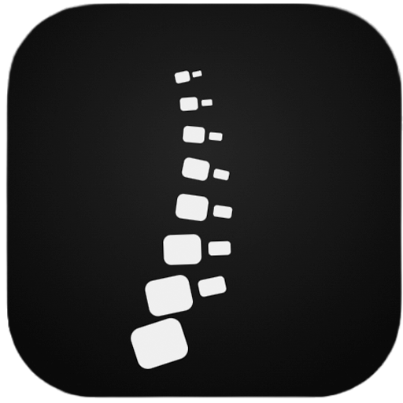
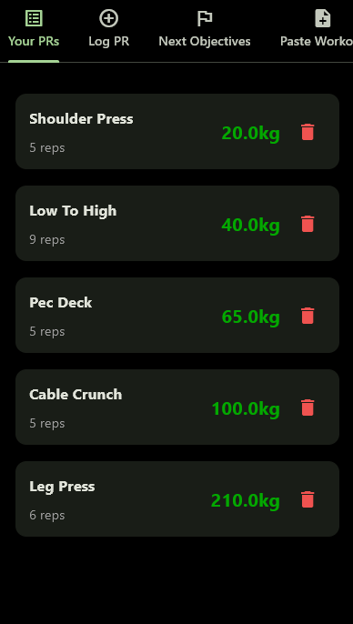
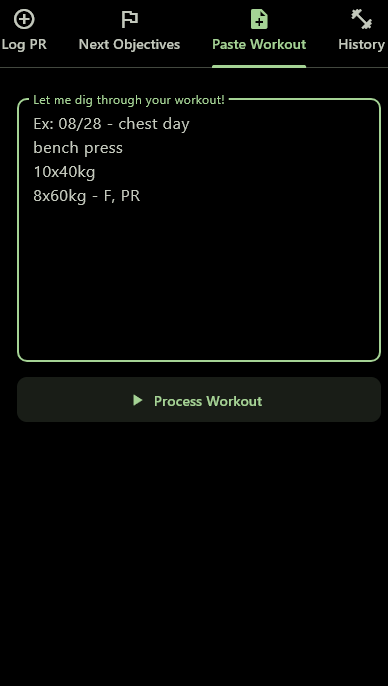
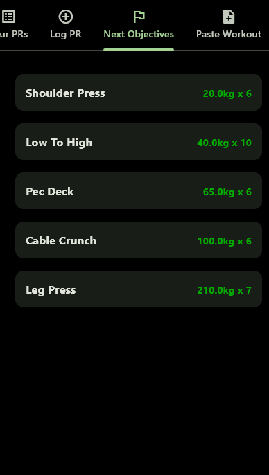

<p align="center">
  
</p>

<h1 align="center">Backbone</h1>

<p align="center">
  A workout tracker for Android and desktop where you just paste your training log and the app does the rest.
</p>

> 🚧 **Status:** in development (v1.12a). Built solo with Python and Flet.

## Why I built it

I already log my workouts as plain text in my notes, but it was tiring to figure out my next objective for each exercise on the day. Backbone reads that text directly: you paste the workout, and it extracts the exercises, sets, reps and weights, detects personal records, and keeps everything organized.

## Screenshots

<p align="center">
  
  
  
</p>

## Features

- **Paste Workout:** write a workout in free text and the parser extracts exercises, sets, reps and weights
- **Your PRs:** a personal record for each exercise, detected automatically from your logs
- **Log PR:** add a PR manually
- **Next Objectives:** the next target for each exercise, based on your current PR
- **History:** every logged workout with date and title, expandable and editable
- **Languages:** interface available in Portuguese and English 
- **Local storage:** data saved in a **SQLite** database on the device

## Workout format

```text
08/28 - your title
bench press
10x 40kg
8x 60kg - F, PR (notes)
```

The first line holds the date and an optional title. Then comes the exercise name, followed by one line per set (`reps x weight`). Tags after the set (`F` for failure, `PR` for personal record) and notes in parentheses are optional.

## Tech stack

- **Python**
- **Flet** (UI, Android and desktop)
- **SQLite3** (local database)

## Project structure

| File | Purpose |
|---|---|
| `main.py` | App entry point |
| `interface.py` | UI screens and navigation |
| `workout_parser.py` | Parses pasted workouts into structured data |
| `database.py` | SQLite database layer |
| `exercises.py` | Exercise list and name translations |
| `translations.py` | PT/EN texts |

## Running it

`pip install -r requirements.txt` and then `python main.py`

## Known issues

- Workouts pasted without a title appear as "No title" in the history
- Exercise name translation stopped working after the move to a database and needs to be reworked
- The database is local only; an online version is planned
- The exercise list is still limited
- The UI is a work in progress

## License

All rights reserved. This code is public for viewing and evaluation only. See [LICENSE](LICENSE).