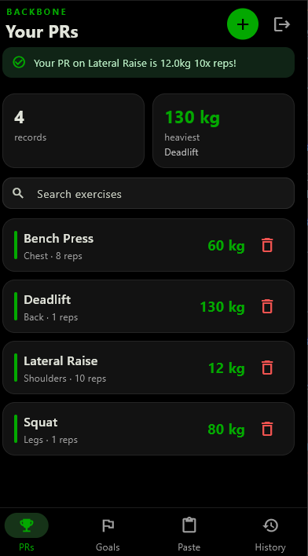
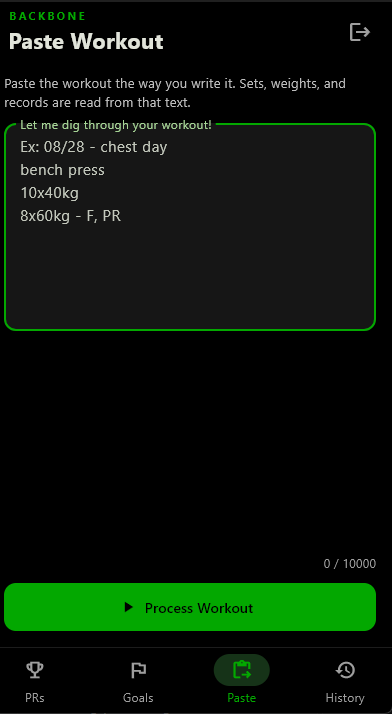
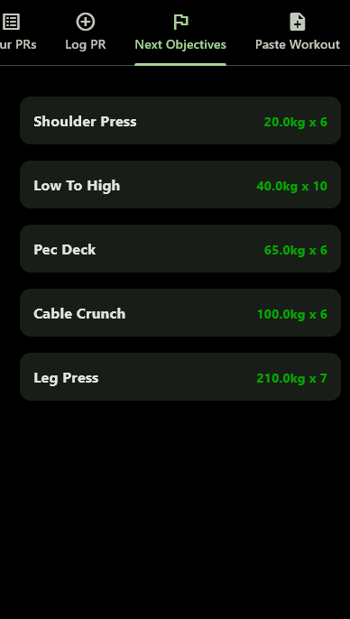

<p align="center">
  
</p>

<h1 align="center">Backbone</h1>

<p align="center">
  A workout tracker for Android and desktop where you just paste your training log and the app does the rest.
</p>

> 🚧 **Status:** in development (v1.17a). Built solo with Python and Flet.

## Why I built it

I already log my workouts as plain text in my notes, but it was tiring to figure out my next objective for each exercise on the day. Backbone reads that text directly: you paste the workout, and it extracts the exercises, sets, reps and weights, detects personal records, and keeps everything organized.

## Screenshots

<p align="center">
  
  
  
</p>

## Features

- **Account:** the app opens on a sign-in screen. Create an account or sign in, and the API keeps your exercises and PRs. If the session expires, Backbone returns to the login screen
- **Paste Workout:** write a workout in free text and the parser extracts exercises, sets, reps and weights
- **Your PRs:** a personal record for each exercise, detected automatically from your logs and stored on your account
- **Log PR:** add a PR manually
- **Next Objectives:** the next target for each exercise, based on your current PR
- **History:** every logged workout with date and title, expandable and editable. This log still lives on the device
- **Languages:** interface available in Portuguese and English

## Workout format

```text
28/08 - your title
bench press
10x 40kg
8x 60kg - F, PR (notes)
10x 100kg - W
```

The first line holds the date as day/month and an optional title. Then comes the exercise name, followed by one line per set (`reps x weight`). Tags after the set are optional: `F` for failure, `PR` for personal record, and `W` for a warmup set, which is ignored when detecting a PR. Notes in parentheses are optional.

## How the online part works

```text
Backbone app (Flet)  →  Backbone API (Flask)  →  PostgreSQL (Neon)
```

The app never talks to the database directly. A database connection string bundled into an Android app could be extracted by anyone, so only the API holds the credentials. The login screen calls the API, receives a signed token, and sends it with each request. The API reads the user from the token, so a user can only see and change their own exercises and PRs.

Accounts, exercises and PRs already go through the hosted API. The pasted workout history is still a local JSON file.

The backend lives in its own repository, **`backbone-api`**, which also has the setup instructions (database, `.env` and running the server).

## Tech stack

- **Python**
- **Flet** (UI, Android and desktop)
- **requests** (HTTP client the app uses for accounts, exercises and PRs)
- **Flask**, **PostgreSQL / Neon**, **psycopg2**, **bcrypt** (online backend, in `backbone-api`)

## Project structure

| File | Purpose |
|---|---|
| `main.py` | App entry: login first, then the tracker |
| `login.py` | Sign-in and account creation |
| `core.py` | Processing workouts, logging PRs and objectives |
| `workout_parser.py` | Parses pasted workouts into structured data |
| `api_client.py` | HTTP client for the hosted API. This is what the app uses for accounts, exercises and PRs |
| `database.py` | Earlier local SQLite layer. The running app no longer uses it |
| `translations.py` | PT/EN texts |

## Roadmap

- [x] PostgreSQL schema and data layer (users, exercises, PRs)
- [x] Flask API with token authentication (register, login, PRs, exercises)
- [x] HTTP client for the app (`api_client.py`), tested against the API
- [x] API routes for PRs by muscle group and for deleting all PRs of an exercise
- [x] Host the API
- [x] Login screen in the app
- [x] Switch accounts, exercises and PRs from local SQLite to the API
- [ ] Move the workout log (JSON) to the online database
- [ ] Exercise name translation stopped working after the move to a database and needs to be reworked
- [ ] Connect different exercise names (translations) to a single output
- [ ] Add a variety of exercises

## License

All rights reserved. This code is public for viewing and evaluation only. See [LICENSE](LICENSE).
